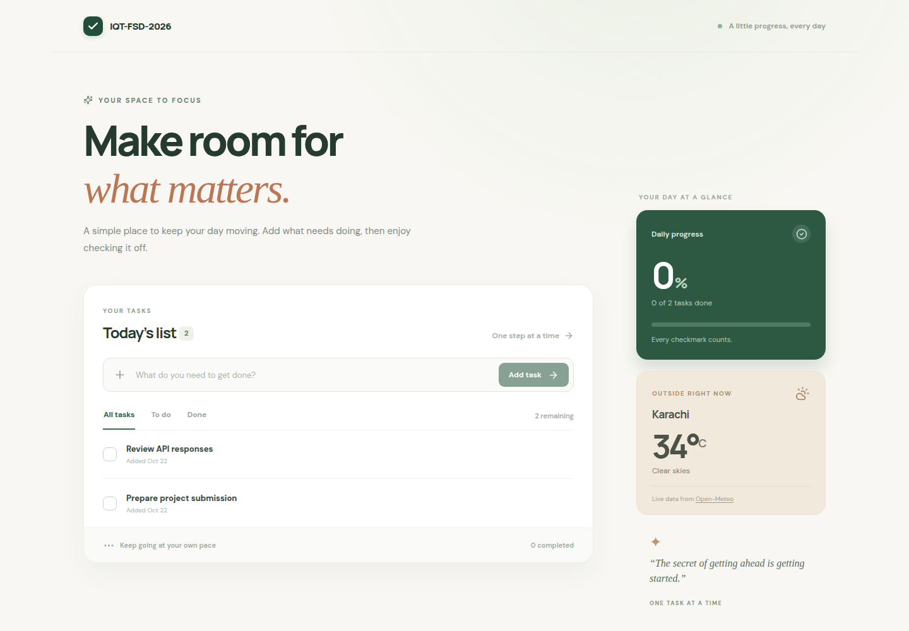

# IQT-FSD-2026

A responsive task board built with React, Spring Boot, and MySQL. Tasks can be added, edited, completed, and deleted. A live Karachi weather card demonstrates integration with a public API.

**Repository:** https://github.com/AbdulMoiiz/iqt-fsd-2026  
**Live demo:** Not deployed. Run the complete application with Docker Compose.

## Start the application

1. Install Docker Desktop or another Docker engine with Compose.
2. Copy `.env.example` to `.env` and replace both example passwords.
3. Run `docker compose up --build -d --wait`.
4. Open `http://localhost:8080` (or the port set by `APP_PORT`).

Application services and builds run in containers. The smoke script sends HTTP requests from the host to the containerized app. Stop the services with `docker compose down`. To remove stored tasks as well, run `docker compose down -v`.

| Variable | Required | Purpose |
| --- | --- | --- |
| `MYSQL_DATABASE` | Yes | Database created by the MySQL container |
| `MYSQL_USER` | Yes | Application database user |
| `MYSQL_PASSWORD` | Yes | Application database password |
| `MYSQL_ROOT_PASSWORD` | Yes | MySQL administrative password |
| `APP_PORT` | No | Published web port; defaults to `8080` |

Compose passes `SPRING_DATASOURCE_URL`, `SPRING_DATASOURCE_USERNAME`, and `SPRING_DATASOURCE_PASSWORD` to the backend. The Open-Meteo integration needs no API key. `.env` is ignored by Git; do not commit real passwords. The backend and database are reachable only on the Compose network.

## API

The frontend calls the API through the same origin. The only business endpoints are:

| Method | Path | Behavior |
| --- | --- | --- |
| `GET` | `/api/tasks` | Return all tasks, newest first |
| `POST` | `/api/tasks` | Create a task |
| `PATCH` | `/api/tasks/{id}` | Change title, completion state, or both |
| `DELETE` | `/api/tasks/{id}` | Delete a task; returns `204` |

Create request: `{"data":{"title":"Prepare the demo"}}`. Update request: `{"data":{"completed":true}}`. Successful reads and writes use `{"data":...}`. Errors use `{"error":{"code":"...","message":"...","fields":{}}}`. Titles must contain non-whitespace text and be at most 160 characters. Empty updates return `400`; missing tasks return `404`.

`/actuator/health` is an internal container health endpoint and is not exposed through Nginx.

## Database schema

Flyway migration `V1__create_tasks.sql` creates:

| Column | MySQL type | Meaning |
| --- | --- | --- |
| `id` | `BIGINT` primary key, auto increment | Task identifier |
| `title` | `VARCHAR(160) NOT NULL` | Task text |
| `completed` | `BOOLEAN NOT NULL DEFAULT FALSE` | Completion state |
| `created_at` | `TIMESTAMP(6) NOT NULL` | Creation time in UTC |
| `updated_at` | `TIMESTAMP(6) NOT NULL` | Last change time in UTC |

`idx_tasks_created (created_at DESC, id DESC)` supports the list order. Flyway applies migrations at startup and Hibernate validates the mapped schema without modifying it.

## Public API integration

The weather card calls the [Open-Meteo Forecast API](https://open-meteo.com/en/docs) from the browser for Karachi’s current temperature and weather code. The frontend maps the code to a short condition label. A failed weather request shows a retry option and leaves task actions available. No additional backend route or API credential is needed.

The integration was added in [this GitHub commit](https://github.com/AbdulMoiiz/iqt-fsd-2026/commit/699875d54844c27c3efd60f8ce84da64ce9d68af). See [architecture and review answers](docs/architecture-review.md) for the four written assessment questions.

## Verification

`docker compose up --build -d --wait` runs the Maven tests and TypeScript build in Docker build stages. Run `bash scripts/smoke.sh` to check CRUD, validation, missing-task behavior, and persistence after a database restart. GitHub Actions runs the same container build and smoke checks on pushes and pull requests.
